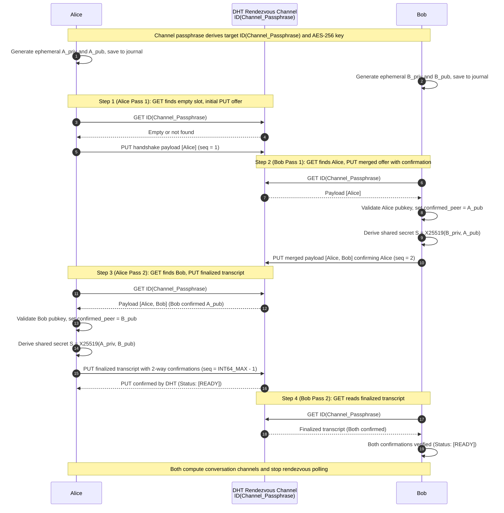
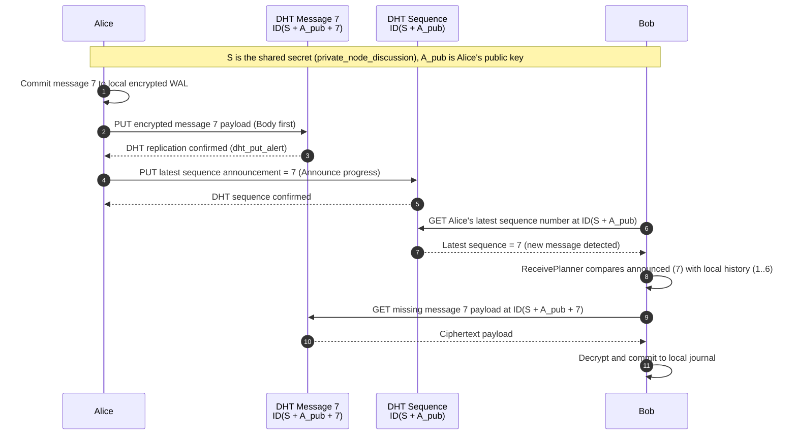
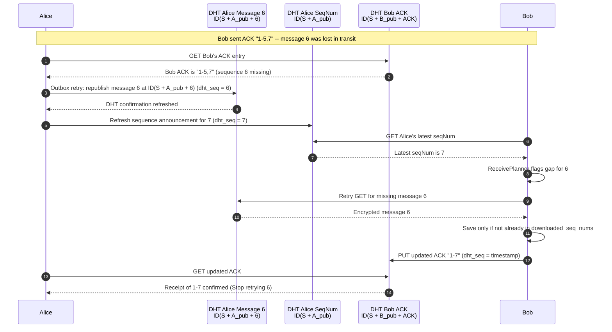
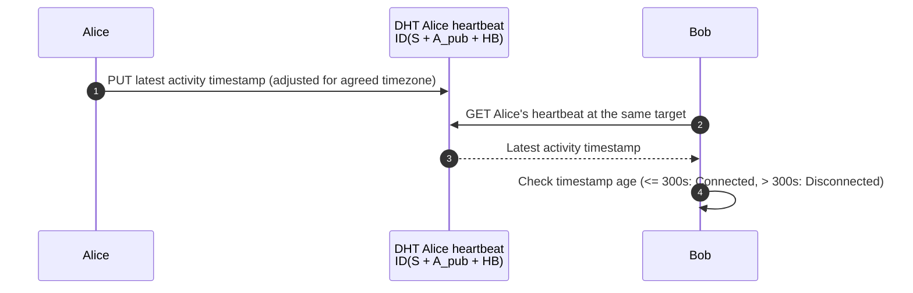
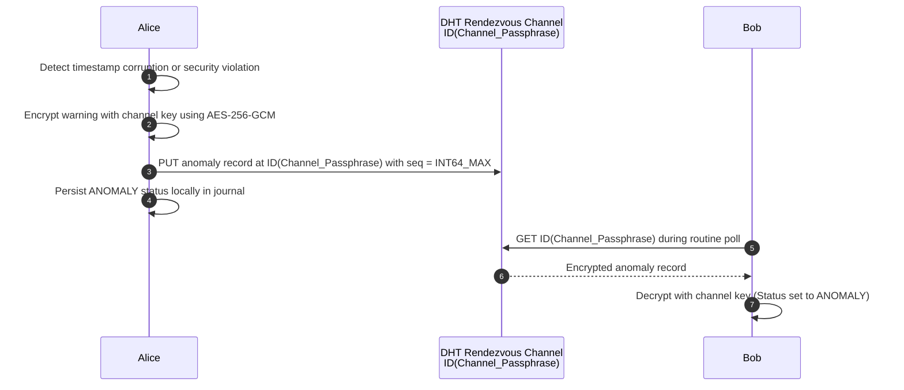
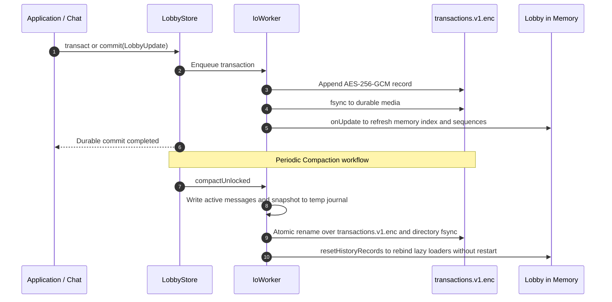

# AnoDrop 💧

**Serverless, Decentralized, Asynchronous Messaging via the BitTorrent DHT (BEP 44)**

[](https://en.cppreference.com/w/cpp/23)
[](https://cmake.org/)
[](LICENSE)
[](https://www.bittorrent.org/beps/bep_0044.html)
[](https://openssl.org/)
[-brightgreen.svg)]()

> **What if a messaging application could operate without running any central messaging server or infrastructure?**  
> AnoDrop turns the global, millions-of-nodes BitTorrent Distributed Hash Table (DHT) into a decentralized, anonymous, asynchronous message-drop system.

---

## Table of Contents

1. [What is AnoDrop?](#what-is-anodrop)
2. [Key Features](#key-features)
3. [Quick Start & Installation](#quick-start--installation)
   - [Prerequisites & Dependencies](#prerequisites--dependencies)
   - [Building from Source](#building-from-source)
   - [Configuration (`config.json`)](#configuration-configjson)
   - [Running the Application](#running-the-application)
   - [First Launch & TUI Controls](#first-launch--tui-controls)
4. [How It Works Under the Hood](#how-it-works-under-the-hood)
   - [DHT Addressing & Cryptographic Derivations](#dht-addressing--cryptographic-derivations)
   - [Mutual Peer Confirmation Handshake](#mutual-peer-confirmation-handshake)
   - [Outbox Architecture: Durability Before Visibility](#outbox-architecture-durability-before-visibility)
5. [Sequence Diagrams](#sequence-diagrams)
   - [1. Mutual Peer Confirmation Handshake](#1-mutual-peer-confirmation-handshake)
   - [2. Message Drop & Outbox Architecture](#2-message-drop--outbox-architecture)
   - [3. Monotonic Acknowledgments & Resync](#3-monotonic-acknowledgments--resync)
   - [4. Presence Heartbeats & Timezone Privacy](#4-presence-heartbeats--timezone-privacy)
   - [5. Tamper Detection & Anomaly Warnings](#5-tamper-detection--anomaly-warnings)
   - [6. Append-Only Encrypted Journal & Atomic Compaction](#6-append-only-encrypted-journal--atomic-compaction)
6. [Forensic & Diagnostic Tool (`decrypt_store`)](#forensic--diagnostic-tool-decrypt_store)
7. [Testing & Quality Assurance](#testing--quality-assurance)
8. [License](#license)

---

## What is AnoDrop?

Traditional messengers (Signal, Telegram, WhatsApp, Matrix) rely on central relays or home servers. If those servers are down, censored, blocked, or compromised, communication breaks down or exposes communication metadata.

**AnoDrop** eliminates servers entirely:
- **No central server, no accounts, no phone numbers, no metadata harvesting.**
- Two users agree out-of-band on a shared **channel passphrase** (e.g., `secret-rendezvous-channel`).
- Using **BEP 44** ([Storing arbitrary data in the BitTorrent DHT](https://www.bittorrent.org/beps/bep_0044.html)), both users find each other on the DHT at an encrypted rendezvous target.
- They perform a **3-way mutual key exchange** using **X25519 ECDH** to establish a shared conversation secret that is **never transmitted over the wire**.
- Messages are deposited into derived DHT targets. The recipient queries the DHT and retrieves them asynchronously—even if the sender is already offline.

---

## Key Features

- **Decentralized & Serverless**: Leverages the public BitTorrent DHT network. No proprietary relay servers, no centralized federation.
- **Mutual Peer Confirmation Handshake**: Symmetric discovery with explicit mutual confirmations (`confirmed_peer`) and CSMA/CA-inspired adaptive timers, completely eliminating handshake split-brain and impersonation vulnerabilities.
- **Outbox Architecture**: Payload-first replication guarantee (`fsync` to local WAL $\to$ PUT payload to DHT $\to$ wait for replication ACK $\to$ PUT sequence advance). Prevents retrieval race conditions where a peer sees a sequence bump before the message payload arrives at DHT replicas.
- **Strict Durability Before Visibility**: No state transition is visible in RAM before being authenticated and `fsync`ed to disk.
- **Memory Hardening (`SecureString`)**: Plaintext message contents are encapsulated in `SecureString` and automatically wiped from RAM upon destruction via `OPENSSL_cleanse`.
- **Authenticated WAL & Envelope Encryption**: Storage relies on `EncryptedJournal` (`transactions.v1.enc`), protected with inter-process `flock`, positional AAD (`"AnoDropJournal/v1/<index>"`), and AES-256-GCM. Master password rotations only re-encrypt the 32-byte DEK in `vault.enc` without re-writing message history.
- **Atomic Compaction**: Obsolete intermediate state transactions are consolidated in the background into single-pass snapshots via atomic file replacement (`rename` + directory `fsync`), eliminating disk bloat.
- **Metadata & Timezone Privacy**: Presence heartbeats use negotiated synthetic timezone offsets, hiding the user's real geographic location and IP time offsets.
- **Hardware/Interface Kill-Switch**: Configurable exclusive binding to specific VPN or WireGuard network interfaces (`wg0`, `tun0`, `nordlynx`).
- **Comprehensive Terminal Interface (TUI)**: Fast, flicker-free ncurses interface using MVVM architecture with non-blocking worker threads.

---

## Quick Start & Installation

### Prerequisites & Dependencies

AnoDrop requires a Linux environment with a C++23 compliant compiler (`g++-13+` or `clang++-17+`), CMake, and the following libraries:

#### Ubuntu / Debian (22.04+)
```bash
sudo apt update
sudo apt install -y \
    build-essential \
    cmake \
    libtorrent-rasterbar-dev \
    libssl-dev \
    libncurses-dev \
    libspdlog-dev \
    nlohmann-json3-dev \
    libargon2-dev
```

#### Arch Linux
```bash
sudo pacman -S base-devel cmake libtorrent-rasterbar openssl ncurses spdlog nlohmann-json argon2
```

#### Fedora (39+)
```bash
sudo dnf install -y \
    gcc-c++ \
    cmake \
    rb_libtorrent-devel \
    openssl-devel \
    ncurses-devel \
    spdlog-devel \
    json-devel \
    libargon2-devel
```

---

### Building from Source

```bash
# Clone the repository
git clone https://github.com/PixiesRAC/AnoDrop.git
cd AnoDrop

# Configure with CMake (Release mode recommended)
cmake -S . -B build -DCMAKE_BUILD_TYPE=Release -DBUILD_TESTING=ON

# Compile the AnoDrop executable, tools, and tests
cmake --build build -j$(nproc)
```

The build produces:
- `build/AnoDrop`: Main messaging application with ncurses TUI.
- `build/decrypt_store`: Forensic and recovery CLI utility to inspect offline encrypted stores.
- `build/tests/regression/anodrop_regression`: Contract and logic regression suite.
- `build/tests/regression/anodrop_e2e`: Functional end-to-end test runner driving real virtual terminals (`forkpty`).

---

### Configuration (`config.json`)

AnoDrop reads its configuration from `config.json` by default (or via `-c /path/to/config.json`). Copy the provided example to get started:

```bash
cp config.example.json config.json
```

```json
{
  "store_path": "./store",
  "log_path": "./anodrop.log",
  "fetch_interval_ms": 5000,
  "argon2_iterations": 5,
  "max_concurrent_fetches": 16,
  "extra_salt_data_for_lobby_handshake": "AnoDrop",
  "log_level": "info",
  "network_interface": "any"
}
```

| Parameter | Description |
|---|---|
| `store_path` | Directory where `vault.enc` and `transactions.v1.enc` are stored. |
| `log_path` | Path to the structured application log file. |
| `fetch_interval_ms` | Interval (in ms) between background DHT polling cycles (default: `5000`). |
| `argon2_iterations` | Computational cost for Argon2id key derivation (default: `5`). |
| `max_concurrent_fetches` | Maximum parallel DHT `get` queries in flight (default: `16`). |
| `extra_salt_data_for_lobby_handshake` | Shared domain salt. All communicating parties must use identical values. |
| `log_level` | Logger verbosity: `trace`, `debug`, `info`, `warn`, `err`, `critical`, `off`. |
| `network_interface` | Kill-switch binding: `"any"` (default) or network device name (e.g., `"tun0"`, `"wg0"`). |

---

### Running the Application

```bash
# Run with default config (looks for ./config.json)
./build/AnoDrop

# Or specify a custom config file
./build/AnoDrop -c /path/to/my_config.json
```

---

### First Launch & TUI Controls

1. **Master Password Prompt (`ui::Unlock`)**:
   - On the very first run, enter a strong master password to initialize the encrypted vault (`vault.enc`).
   - On subsequent runs, enter the master password to unlock the Data Encryption Key (DEK) and replay the encrypted journal (`transactions.v1.enc`).

2. **Main Menu Navigation (`ui::GuiBuilder`)**:
   Once unlocked, AnoDrop presents a numbered interactive terminal menu:
   ```text
   === AnoDrop: Decentralized Messaging ===
   1. Handshake (Find new lobbies)
   2. Display Unlocked Lobbies
   3. Change Master Password
   4. Flag Lobby Anomaly
   5. Exit

   Use ARROWS to navigate, ENTER to select.
   ```
   - **`UP` / `DOWN`**: Move selection.
   - **`ENTER`**: Open the selected option.
   - **`q` / `Q`**: Exit the application.

3. **Option 1: Handshake (Join / Create a Lobby)**:
   - Select `1` and press `ENTER`.
   - **Enter Channel Name (Passphrase)**: Enter the shared rendezvous passphrase agreed upon with your peer (e.g., `secret-channel`).
   - **Enter your Pseudo**: Enter your local display handle.
   - AnoDrop generates ephemeral X25519/Ed25519 keys, begins DHT rendezvous discovery via `HandshakeCoordinator`, and adds the lobby to the local store.

4. **Option 2: Display Unlocked Lobbies (`ui::LobbiesView`)**:
   - Lists all registered lobbies and their real-time state:
     - `[PENDING]`: 3-way handshake in progress on the DHT.
     - `[READY]`: Handshake completed (`HANDSHAKE_DONE`), mutual keys exchanged and verified.
     - `[Connected]` / `[Disconnected]`: Peer presence status based on heartbeat freshness ($\le 300\text{s}$).
     - `* NEW MSG *`: Unread messages waiting in the lobby.
     - `[ERROR]`: Anomaly flagged (`LobbyStatus::ANOMALY`). Displays ` - Anomaly: <reason>` in red. Chat remains accessible and messages can still be exchanged.
   - **`UP` / `DOWN`**: Select a lobby.
   - **`ENTER`**: Open the chat view (available once status is `[READY]` or `[ERROR]`).
   - **`d` / `DEL` / `Backspace`**: Forget / hide the selected lobby.
   - **`q` / `Q`**: Return to the main menu.

5. **Chat View & Messaging (`ui::ChatView`)**:
   - Displays real-time conversation history with delivery indicators:
     - `[Sending...]`: Message committed to local WAL; payload uploading to DHT replicas.
     - `[Sent]`: Payload confirmed on DHT replicas; sequence counter announced.
     - `[Ack]`: Peer retrieved and committed the message to their local store.
     - `[Sending resync...]` / `[Sent (via resync)]` / `[Ack (via resync)]`: Status indicators during unacknowledged message recovery.
   - **Interactive Elements**:
     - **Message Input Prompt** (`> ..._`): Type text directly.
     - **`[ Leave Chat ]` Button**: Return to the lobbies menu.
     - **`[ Resync Pending ]` Button**: Trigger manual resynchronization of unacknowledged messages.

#### Keybindings & Shortcuts Reference

| Screen | Key | Action |
|---|---|---|
| **Main Menu** | `Up` / `Down` | Move menu selection (options 1 to 5) |
| **Main Menu** | `Enter` | Activate selected option |
| **Main Menu** | `q` / `Q` | Exit application |
| **Lobbies List** | `Up` / `Down` | Select lobby |
| **Lobbies List** | `Enter` | Open chat for the selected lobby (when `[READY]`) |
| **Lobbies List** | `d` / `Del` / `Backspace` | Forget / hide selected lobby |
| **Lobbies List** | `q` / `Q` | Return to Main Menu |
| **Chat View** | `Tab` | Cycle focus: Input box $\leftrightarrow$ `[ Leave Chat ]` $\leftrightarrow$ `[ Resync Pending ]` |
| **Chat View** | `Left` / `Right` | Toggle between `[ Leave Chat ]` and `[ Resync Pending ]` |
| **Chat View** | `Up` / `Down` | Switch focus between input and buttons / scroll history |
| **Chat View** | `PageUp` / `PageDown` | Fast scroll message history |
| **Chat View** | `Enter` (on input) | Send message |
| **Chat View** | `Enter` (on `[ Leave Chat ]`) | Return to Lobbies list |
| **Chat View** | `Enter` (on `[ Resync Pending ]`) | Resynchronize pending messages (`ChatResyncer`) |
| **Password / Anomaly** | `Enter` / `q` | Confirm input / cancel and return |

---

## How It Works Under the Hood

### DHT Addressing & Cryptographic Derivations

All communication occurs via mutable BEP 44 items. Target addresses are deterministically derived:

$$\text{Seed} = \text{HKDF-SHA256}(\text{Input}, \text{info} = \text{"DHTSeed"})$$
$$\text{KeyPair} = \text{Ed25519-From-Seed}(\text{Seed})$$
$$\text{Target ID} = \text{SHA1}(\text{PublicKey}_{\text{Ed25519}} \parallel \text{Salt})$$

Where `S` is the shared secret derived via X25519 ECDH ($S = \text{X25519}(K_{\text{priv}}, K_{\text{pub}}^{\text{peer}})$), and `A_pub` / `B_pub` are the X25519 public keys.

| Channel / Item | Target Derivation | Salt | Payload & Purpose |
|---|---|---|---|
| **Rendezvous Slot** | `ID(Channel_Passphrase)` | Domain Salt | AES-256-GCM encrypted 3-way handshake transcript |
| **Sequence Announcement** | `ID(S + A_pub)` | None | Monotonic BEP 44 sequence number representing latest message $N$ |
| **Message Payload $N$** | `ID(S + A_pub + N)` | `std::to_string(N)` | Encrypted message content, timestamp, and message ID |
| **Monotonic ACK** | `ID(S + A_pub + "_ACK")` | `"ack"` | Compressed list of received sequence numbers (e.g. `"1-5,7"`) |
| **Presence Heartbeat** | `ID(S + A_pub + "_HEARTBEAT_")` | `"heartbeat"` | Encrypted timestamp adjusted for agreed fake timezone |
| **Anomaly Tombstone** | `ID(Channel_Passphrase)` | Domain Salt | Tamper alert published at `seq = INT64_MAX` replacing handshake |

---

### Mutual Peer Confirmation Handshake

To prevent impersonation, split-brain states, and race conditions during simultaneous connections:
1. **Symmetric Discovery**: Every handshake pass starts with a `GET` before deciding whether to `PUT`. Blind writes never occur.
2. **Mutual Confirmation (`confirmed_peer`)**: Alice publishes $A_{\text{pub}}$. Bob reads $A_{\text{pub}}$ and publishes a record containing both keys with `confirmed_peer = A_pub`. Alice reads this, validates Bob, and publishes a finalized record with `confirmed_peer = B_pub`.
3. **Adaptive CSMA/CA Delays**: If both clients write simultaneously, collisions are resolved using:
   $$\text{Delay} = \text{BaseInterval} + \text{PubkeyOffset}(K_{\text{pub}}) + \text{RandomJitter}(0..20\text{s})$$
4. **Deterministic Timezone Tie-Break**: Whichever client has the lexicographically smaller Ed25519 public key dictates the synthetic timezone offset for heartbeat calculations.

---

### Outbox Architecture: Durability Before Visibility

Publishing the sequence number before the message payload causes a classic distributed systems race condition: a fast recipient notices the sequence bump, attempts to fetch the payload, and fails because DHT storage replicas have not received it yet.

AnoDrop strictly enforces the **Outbox Pattern**:
1. **Local WAL Append**: Message is assigned sequence $N$ and written to `transactions.v1.enc` with `fsync()`.
2. **Payload Deposit**: Message body is published to `ID(S + A_pub + N)`.
3. **Replication Confirmation**: The DHT engine waits for `dht_put_alert` confirmation from storage nodes.
4. **Sequence Advancement**: Only then is the sequence counter at `ID(S + A_pub)` updated to $N$.
5. **Bounded Lookahead Planning**: The recipient's `ReceivePlanner` detects the sequence gap and fetches missing items up to `max_concurrent_fetches`, avoiding bandwidth spikes.

---

## Sequence Diagrams

### 1. Mutual Peer Confirmation Handshake

> **Use Case & Context:**  
> Alice and Bob want to establish a private, serverless conversation. They have no shared directory, server, or user accounts, but they have agreed out-of-band on a shared channel passphrase (e.g., `meeting-alpha-2026`).  
> **Problem Solved:**  
> On an uncoordinated public network like the BitTorrent DHT, concurrent writes can cause split-brain collisions where different storage replicas hold conflicting keys. AnoDrop's 3-way handshake with explicit `confirmed_peer` tokens and adaptive delays guarantees that both parties converge on a single, mutually verified cryptographic session before any messages are sent.

Two clients meet at the rendezvous target `ID(Channel_Passphrase)`, exchange keys symmetrically, and confirm each other's identity without a server. All payloads on this slot are AES-256-GCM encrypted using a key derived from the shared channel passphrase (`HandshakeKey`).



#### Payload Structure at Each Step

The payload stored in the rendezvous item is a JSON array of `PeerInfo` structs, encrypted with AES-256-GCM. Items are sorted canonically by `x25519_pub` to ensure deterministic ordering.

##### Step 1: Alice's Initial Offer (`PENDING_HANDSHAKE`)
- **BEP 44 DHT Sequence Number (`dht_seq`)**: `1`
- **DHT Target & Salt**: `ID(Channel_Passphrase)`, Salt = `Config salt`
- Alice publishes only her own information. Her `confirmed_peer` is empty because she has not seen Bob yet:

```json
[
  {
    "pseudo": "Alice",
    "x25519_pub": "a1b2c3d4... (Alice's 64-char hex X25519 public key)",
    "fake_timezone": {
      "offset_seconds": 3600,
      "name": "UTC+1"
    },
    "confirmed_peer": "",
    "protocol_version": 2
  }
]
```

##### Step 2: Bob's Merged Confirmation Offer (`CONFIRMATION_PENDING`)
- **BEP 44 DHT Sequence Number (`dht_seq`)**: `2`
- **DHT Target & Salt**: `ID(Channel_Passphrase)`, Salt = `Config salt`
- Bob fetches Alice's record, derives the shared root $S = \text{X25519}(\text{Bob\_priv}, \text{Alice\_pub})$, and publishes a merged record where he explicitly confirms Alice's public key:

```json
[
  {
    "pseudo": "Alice",
    "x25519_pub": "a1b2c3d4... (Alice's X25519 public key)",
    "fake_timezone": {
      "offset_seconds": 3600,
      "name": "UTC+1"
    },
    "confirmed_peer": "",
    "protocol_version": 2
  },
  {
    "pseudo": "Bob",
    "x25519_pub": "d4e5f6a7... (Bob's X25519 public key)",
    "fake_timezone": {
      "offset_seconds": 7200,
      "name": "UTC+2"
    },
    "confirmed_peer": "a1b2c3d4...",
    "protocol_version": 2
  }
]
```

##### Step 3: Alice's Finalized Mutual Transcript (`HANDSHAKE_DONE`)
- **BEP 44 DHT Sequence Number (`dht_seq`)**: `9223372036854775806` (`INT64_MAX - 1`)
- **DHT Target & Salt**: `ID(Channel_Passphrase)`, Salt = `Config salt`
- Alice fetches Bob's offer, verifies that Bob confirmed her key (`confirmed_peer == Alice_pub`), derives the same root $S$, sets her own `confirmed_peer = Bob_pub`, harmonizes the fake timezone (the lexicographically smaller public key wins), and writes the finalized transcript at sequence `INT64_MAX - 1`:

```json
[
  {
    "pseudo": "Alice",
    "x25519_pub": "a1b2c3d4...",
    "fake_timezone": {
      "offset_seconds": 3600,
      "name": "UTC+1"
    },
    "confirmed_peer": "d4e5f6a7...",
    "protocol_version": 2
  },
  {
    "pseudo": "Bob",
    "x25519_pub": "d4e5f6a7...",
    "fake_timezone": {
      "offset_seconds": 3600,
      "name": "UTC+1"
    },
    "confirmed_peer": "a1b2c3d4...",
    "protocol_version": 2
  }
]
```

##### Step 4: Bob Confirms Finalized State (`HANDSHAKE_DONE` $\to$ `[READY]`)
- **BEP 44 DHT Sequence Number (`dht_seq`)**: Verifies received `dht_seq == 9223372036854775806` (`INT64_MAX - 1`)
- Bob polls `ID(Channel_Passphrase)`, verifies that both participants have mutually confirmed each other (`ourConfirmationPresent && peer.confirmed_peer == Bob_pub`), and marks the lobby as `[READY]`. Both clients cease polling the rendezvous slot and transition to conversation-specific channels.

---

### 2. Message Drop & Outbox Architecture

> **Use Case & Context:**  
> Alice wants to send a message ("Hi Bob!") to Bob in an established lobby. Alice and Bob cannot connect to each other directly because either or both may be behind symmetric NATs, mobile firewalls, or offline.  
> **Problem Solved:**  
> In distributed hash tables, nodes can be slow or drop packets. If Alice were to increment her sequence counter before the message body was fully replicated, Bob would attempt to fetch a non-existent payload and trigger false alarm errors. AnoDrop enforces the **Outbox Pattern**: the payload is uploaded and confirmed on DHT storage nodes first, and only after receipt of `dht_put_alert` is the public sequence announcement updated.



#### Payload & DHT Item Structure

##### 1. Encrypted Message Body
- **DHT Channel / Target**: `ID(S + A_pub + 7)`
- **Salt**: `"7"` (string of `seq_num`)
- **BEP 44 DHT Sequence Number (`dht_seq`)**: `7` (authoritative message sequence `msg.seq_num`)
- **Plaintext JSON Payload** (before AES-256-GCM encryption with channel key):
```json
{
  "direction": 0,
  "content": "Hi Bob! This is message 7 over BitTorrent DHT.",
  "fake_timestamp": 1774001234,
  "seq_num": 7
}
```

##### 2. Sequence Progress Announcement
- **DHT Channel / Target**: `ID(S + A_pub)`
- **Salt**: `""` (no salt)
- **BEP 44 DHT Sequence Number (`dht_seq`)**: `7` (tracks highest confirmed published sequence)
- **Plaintext Payload**:
```text
"7"
```

---

### 3. Monotonic Acknowledgments & Resync

> **Use Case & Context:**  
> Alice has sent messages 1 through 7, but due to UDP packet loss or DHT churn, message 6 never reached Bob's local store. Bob has successfully received and saved messages 1 through 5, as well as message 7.  
> **Problem Solved:**  
> Cumulative single-number ACKs (such as TCP ACK 6) would force retransmissions of subsequent messages that Bob already received. AnoDrop uses compressed selective ACK ranges (`"1-5,7"`), allowing Alice's `NetworkResyncHandler` (or the user pressing `[ Resync Pending ]`) to pinpoint and retransmit only the missing gap (message 6) without redundant transfers.



#### Payload & DHT Item Structure

##### 1. Compressed Selective ACK on DHT
- **DHT Channel / Target**: `ID(S + B_pub + "_ACK")`
- **Salt**: `"ack"`
- **BEP 44 DHT Sequence Number (`dht_seq`)**: `1774001500` (timestamp-based monotonic sequence: `targetSeq = fakeTimestamp > current_dht_seq ? fakeTimestamp : current_dht_seq + 1`)
- **Payload**:
```text
"1-5,7"
```
> **Meaning:** Bob has persistently stored messages 1 to 5 and message 7. Message 6 is the missing gap.

##### 2. Automatic Outbox Retransmission (Republish Missing Slot)
- **DHT Channel / Target**: `ID(S + A_pub + 6)`
- **Salt**: `"6"`
- **BEP 44 DHT Sequence Number (`dht_seq`)**: `6` (`NetworkResyncHandler` republishes the unconfirmed slot)
- **Plaintext JSON Payload**:
```json
{
  "direction": 0,
  "content": "Hi Bob! This is message 6.",
  "fake_timestamp": 1774001100,
  "seq_num": 6
}
```

##### 3. Manual Resync Message Payload (Triggered via `[ Resync Pending ]`)
- **DHT Channel / Target**: `ID(S + A_pub + 8)`
- **Salt**: `"8"`
- **BEP 44 DHT Sequence Number (`dht_seq`)**: `8` (assigned by `DhtChat::sendMessage` as `my_seq_num + 1`)
- **Plaintext JSON Payload**:
```json
{
  "direction": 0,
  "content": "[Resync of Seq:6 14:30:00] Hi Bob! This is message 6.",
  "fake_timestamp": 1774001500,
  "seq_num": 8
}
```

##### 4. Sequence Announcement after Manual Resync
- **DHT Channel / Target**: `ID(S + A_pub)`
- **Salt**: `""`
- **BEP 44 DHT Sequence Number (`dht_seq`)**: `8`
- **Plaintext Payload**:
```text
"8"
```

---

### 4. Presence Heartbeats & Timezone Privacy

> **Use Case & Context:**  
> Bob wants to know if Alice is actively online and listening for messages without triggering active ping/pong probes that leak traffic patterns.  
> **Problem Solved:**  
> Real-time timestamps would leak the user's geographic location (local midnight, working hours). AnoDrop harmonizes a synthetic fake timezone during the handshake and publishes obfuscated timestamps to a dedicated heartbeat channel.



#### Payload & DHT Item Structure

##### Heartbeat Record
- **DHT Channel / Target**: `ID(S + A_pub + "_HEARTBEAT_")`
- **Salt**: `"heartbeat"`
- **BEP 44 DHT Sequence Number (`dht_seq`)**: `1774001800` (timestamp-based monotonic seq: `fakeTimestamp > current_dht_seq ? fakeTimestamp : current_dht_seq + 1`)
- **Payload**: Obfuscated Unix timestamp string
```text
"1774001800"
```
> **Online Evaluation:** Bob evaluates $|t_{\text{peer\_now}} - t_{\text{heartbeat}}| \le 300\text{s}$. If within 5 minutes, status displays `[Connected]`; otherwise `[Disconnected]`.

---

### 5. Tamper Detection & Anomaly Warnings

> **Use Case & Context:**  
> An active attacker attempts a replay attack, injects corrupted sequence numbers, or tampers with encrypted payloads on the DHT.  
> **Problem Solved:**  
> Without central moderation, an attack could cause clients to silently discard messages or desynchronize. AnoDrop triggers an irreversible security tombstone published at the rendezvous target with `seq = INT64_MAX`, permanently locking the rendezvous slot and alerting both peers in the UI with a persistent `[ERROR] - Anomaly` banner.



#### Payload & DHT Item Structure

##### Emergency Anomaly Tombstone
- **DHT Channel / Target**: `ID(Channel_Passphrase)` (rendezvous slot)
- **Salt**: `Config salt` (default: `"anodrop_handshake"`)
- **BEP 44 DHT Sequence Number (`dht_seq`)**: `9223372036854775807` (`INT64_MAX`, the maximum possible 64-bit integer)
- **Plaintext JSON Payload** (before AES-256-GCM encryption with channel key):
```json
{
  "anomaly": true,
  "message": "Corrupted timestamp received from peer"
}
```
> **Irreversibility Guarantee:** In BitTorrent BEP 44, nodes accept updates only if `new_seq > old_seq`. Because `INT64_MAX` is the absolute upper bound, no subsequent write can ever overwrite this slot. The rendezvous channel is permanently poisoned and flagged as compromised.

---

### 6. Append-Only Encrypted Journal & Atomic Compaction

> **Use Case & Context:**  
> AnoDrop must store private messages, ratchet states, and lobby metadata locally on disk without ever leaking plaintext to unencrypted disk sectors or risking database corruption on sudden power loss or process kill.  
> **Problem Solved:**  
> Traditional SQLite or flat files risk data corruption during interrupted writes and can leak unencrypted data in temporary journals. AnoDrop uses a custom zero-dependency append-only WAL (`transactions.v1.enc`) protected by AES-256-GCM with positional AAD, atomic `::fsync`, and zero-downtime compaction via temporary atomic rename.



#### Storage Record & On-Disk Binary Structure

##### 1. Binary On-Disk Envelope (`store/transactions.v1.enc`)
- **Storage Layer**: Local Disk Journal (managed by `IoWorker` via single-writer thread)
- **Record Framing**:
```text
[ 4 Bytes LE Payload Length ] [ 12 Bytes Random IV ] [ AES-256-GCM Ciphertext ] [ 16 Bytes GCM Tag ]
```
- **Positional Authenticated Additional Data (AAD)**: `"AnoDropJournal/v1/<record_index>"` (e.g., `"AnoDropJournal/v1/0"`, `"AnoDropJournal/v1/1"`, preventing transposition or truncation attacks).

##### 2. Decrypted Plaintext Transaction Payload (JSON `LobbyUpdate`)
```json
{
  "version": 1,
  "lobby": "secret-channel",
  "update": {
    "my_seq_num": 7,
    "new_message": {
      "direction": 0,
      "content": "Hi Bob! This is message 7 over BitTorrent DHT.",
      "fake_timestamp": 1774001234,
      "seq_num": 7
    },
    "message_sent_confirm": 7,
    "peer_acked_seq_nums": {
      "through": 5,
      "selective": [7]
    }
  }
}
```

---

## Forensic & Diagnostic Tool (`decrypt_store`)

AnoDrop includes `decrypt_store`, a standalone diagnostic binary that inspects, audits, and recovers `vault.enc` and `transactions.v1.enc` offline without starting a network daemon.

### Usage

```bash
./build/decrypt_store <master_password> [store_directory=store]
```

### Sample Output

```text
================================================================================
                  ANODROP - ENCRYPTED JOURNAL INSPECTOR                         
================================================================================
Store directory: "store"

--- [1] VAULT INSPECTION (vault.enc) ---
Vault size: 76 bytes (expected: 76 bytes)
🔒 ENCRYPTED VAULT VIEW (HEX):
   • Argon2id Salt (16 bytes): 4a 1b 88 c3 ...
   • Vault IV (12 bytes)     : 11 9f 44 e2 ...
   • Encrypted DEK (32 bytes): 7d 3a 90 f1 ...
   • GCM Tag (16 bytes)      : c5 a1 0e 84 ...
🔓 DECRYPTED VAULT VIEW (DEK / MASTER KEY):
   ✓ Master password valid! Successful DEK decryption via KEK.
   • DEK / MasterKey (HEX)   : 3f 8c 12 e9 ...

--- [2] JOURNAL RECORD PARSING (transactions.v1.enc) ---
[Transaction #0 | Offset: 0]
🔒 1. ENCRYPTED DISK VIEW (HEX & DECIMAL):
   • Length Prefix (4B LE)  : 214 bytes [ d6 00 00 00 ]
   • Random IV (12B)        : [ c3 82 a4 ... ]
   • GCM Tag Seal (16B)     : [ 90 fb 12 ... ]
   • Positional AAD         : "AnoDropJournal/v1/0"
   • Ciphertext (186 bytes) :
       0000 : 8f 3a 21 ...
🔓 2. DECRYPTED VIEW (PLAINTEXT PAYLOAD):
   ✓ Authenticity verified by AES-GCM tag!
   {
     "type": "create_lobby",
     "lobby_name": "secret-channel",
     "timestamp": 1774000000
   }
================================================================================
Total transactions parsed: 42
Total journal size       : 9814 bytes
================================================================================
```

---

## Testing & Quality Assurance

AnoDrop features a comprehensive 35-test regression and functional test suite with zero Python dependencies, utilizing CMake/CTest and POSIX virtual terminals (`forkpty`).

```bash
# Run all offline regression and contract tests
ctest --test-dir build -L offline --output-on-failure

# Or execute specific test runners directly:
./build/tests/regression/anodrop_regression
./build/tests/regression/anodrop_cpp_runtime
./build/tests/regression/anodrop_network_runtime
./build/tests/regression/anodrop_e2e
```

- **`anodrop_regression` (27 tests)**: Validates state machines, delivery status resolutions, selective ACK compression, sequence gap detection, journal WAL integrity, and password rotation.
- **`anodrop_cpp_runtime` (7 tests)**: Fault injection tests verifying exception safety, memory wiping (`SecureString`), zero leaks on unhandled alerts, and deadlock-free worker draining.
- **`anodrop_e2e`**: End-to-end integration driver that spawns two full AnoDrop processes under POSIX pseudo-terminals (`forkpty`), driving real ncurses screen buffers, performing handshake negotiation, and exchanging encrypted messages.

---

## License

This project is licensed under the MIT License — see the [LICENSE](LICENSE) file for details.

